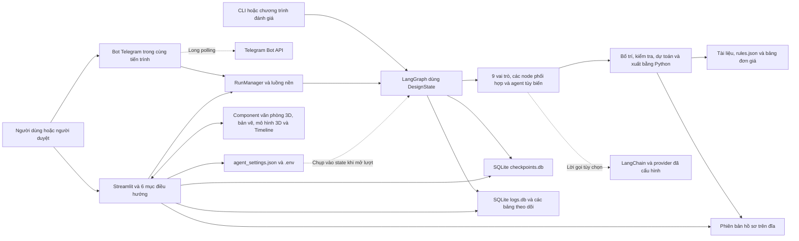
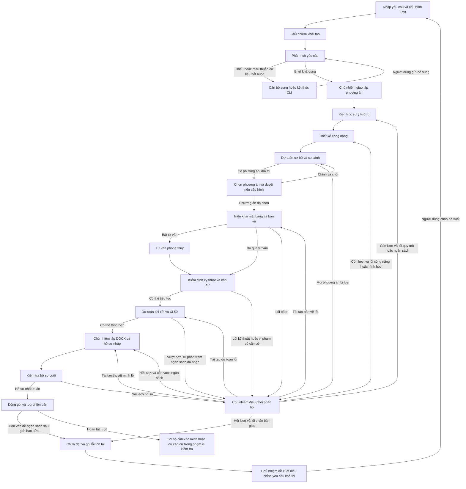

# AI Architect Studio

## Tài liệu đầu vào cho báo cáo môn Quản lý dự án

Tài liệu đối chiếu mã và dữ liệu cục bộ trong thư mục dự án ngày **26/11/2026**, sau các thay đổi về quản lý agent, mô hình 3D, trạng thái agent và bot Telegram (tóm tắt ở mục 9.4). [Kế hoạch đề tài ban đầu](docs/planqlda.md) là tài liệu lịch sử. Các mục ghi **Hiện trạng** có căn cứ từ mã nguồn, cấu hình, kiểm thử hoặc hồ sơ lưu. Các mục ghi **Kế hoạch ban đầu**, **Đề xuất** và **Chưa có dữ liệu** có ý nghĩa riêng khi trích dẫn vào báo cáo. Ví dụ và phép kiểm trong tài liệu đã được giới hạn ở dữ liệu mẫu và các trường kỹ thuật cần thiết.

## 1. Tổng quan dự án

**AI Architect Studio** là nguyên mẫu hỗ trợ thiết kế sơ bộ nhà ở bằng tiếng Việt. Giai đoạn này cần chuyển nhu cầu của chủ nhà thành chương trình công năng, thử cách bố trí, triển khai bản vẽ và ước tính chi phí. Khi nhiều tài liệu được lập riêng, thay đổi mặt bằng có thể dẫn đến lệch số tầng, số phòng, diện tích hoặc phiên bản giữa các sản phẩm. Dự án tổ chức các bước thành một workflow có trạng thái chung, điểm duyệt và vòng phản hồi để người dùng theo dõi và điều chỉnh.

- **Mục tiêu sản phẩm** là nhận brief tiếng Việt, lập và so sánh phương án, xuất hồ sơ sơ bộ nhất quán, giải thích quyết định và dữ liệu còn thiếu. Theo dõi phiên bản, bàn giao, lỗi và kết quả nghiệm thu của từng bước.
- **Người dùng hướng tới** gồm người mô tả nhu cầu xây nhà và duyệt phương án, người rà soát thiết kế sơ bộ, nhóm sinh viên hoặc giảng viên xem demo và đánh giá cách quản lý công việc. Mã hiện tại chưa phân quyền theo nhóm người dùng.
- **Phạm vi kỹ thuật** bao gồm bố trí nhà ở riêng lẻ dạng nhà phố hoặc nhà ống trên lô chữ nhật, 1–5 tầng. Khả năng bố trí phụ thuộc kích thước và nhu cầu công năng. Phạm vi xác minh giới hạn ở các phép kiểm đã cài đặt và nguồn áp dụng đã đối chiếu cho lô đất.
- **Sản phẩm** gồm bản vẽ sơ bộ PDF và DXF (mặt bằng, mặt đứng, mặt cắt và ba tờ phối cảnh 3D), mô hình 3D GLB và DXF 3D, thuyết minh DOCX, dự toán XLSX có công thức, kết quả kiểm tra kỹ thuật và xác minh quy chuẩn. Hệ thống lưu dữ liệu phiên bản và nhật ký bàn giao để truy vết. Người dùng giao việc và duyệt trên web hoặc qua bot Telegram.
- **Giới hạn sản phẩm** bao gồm việc chưa hỗ trợ tính toán kết cấu, bản vẽ thi công hoặc hệ thống điện nước chi tiết, BIM/IFC hay phối cảnh dựng hình (render) chất lượng trình diễn. Mô hình 3D dựng từ mặt bằng sơ bộ bằng khối hộp. Bề dày tường, chiều cao cửa và tường chắn mái theo hằng số của bản vẽ 2D, chi tiết cửa và nội thất mang tính minh họa, mái luôn là mái bằng. Sa bàn văn phòng 3D phục vụ trình bày tiến độ, khác với mô hình 3D của ngôi nhà.

Có thể kiểm tra tại [README](README.md), [kế hoạch ban đầu](docs/planqlda.md) mục 1–2, [bộ bố trí mặt bằng](tools/layout_algorithm.py) `compute_layout()`, [bộ xuất bản vẽ](tools/drawing_set.py) `build_sheets()` và `export_drawings()`, [mô hình 3D](tools/model3d.py) `build_boxes()`.

## 2. Yêu cầu và chức năng

### 2.1. Yêu cầu chức năng

1. Tiếp nhận mô tả tiếng Việt và các trường cấu trúc như mặt tiền, chiều sâu, địa điểm, mã lô, số tầng, số người, số phòng ngủ và ngân sách. Kiểm tra giá trị xung đột, yêu cầu bổ sung kích thước thiếu và trình bày giả định của các trường có thể đề xuất.
2. Tạo lượt thiết kế, tổ chức agent theo trạng thái, phân biệt tự động và điểm duyệt. Cho tạm dừng, tiếp tục hoặc dừng khi trạng thái và checkpoint hỗ trợ.
3. Lập phương án, đối chiếu hình học, brief, ngân sách và căn cứ. Lưu quyết định chọn hoặc sửa phương án, xử lý phản hồi và tái tạo sản phẩm phụ thuộc.
4. Xuất, xem và tải đúng phiên bản hồ sơ. Tách kiểm tra hình học, đối chiếu hồ sơ cuối và xác minh quy chuẩn. Ghi rõ nội dung thiếu căn cứ và cách bổ sung.
5. Theo dõi sự kiện, công việc, lần thực hiện, thời gian xử lý và chờ, tài nguyên model và nghiệm thu. Lưu đánh giá theo phiên bản. Trình bày tiến độ bằng văn phòng 3D, lưu đồ và timeline. Cho biết rõ agent nào đang làm, chờ người dùng, chờ đến lượt hoặc rảnh.
6. Quản lý agent: đổi nhà cung cấp và model cho 6 agent lõi có gọi LLM, nhập khóa API, kiểm tra kết nối. Thêm, sửa, bật/tắt, xóa và chạy thử agent LLM tùy biến. Chín agent lõi cố định, không thêm/sửa/xóa trên giao diện.
7. Giao việc, duyệt từng bước, giao agent làm lại và nhận hồ sơ qua bot Telegram cho tài khoản được cho phép.

Có thể kiểm tra tại [trang Dự án](views/projects.py) `show_intake()`, [phân tích brief](tools/brief_parser.py) `inspect_request()`, [đồ thị](graph.py) `make_approval()`, [chạy nền](monitoring/runner.py) `Run`, [quản lý task](monitoring/tasks.py) `STAGES`, [trang Kết quả](views/results.py), [Quản lý agent](views/agent_manager.py), [bot Telegram](telegram_bot/bot.py) `Bot`.

### 2.2. Yêu cầu phi chức năng thể hiện trong mã

| Yêu cầu | Cách đáp ứng và giới hạn |
|---|---|
| Nhất quán và truy vết | Chung `DesignState` và bảng diện tích. Định danh phương án/phòng/tầng, có lịch sử theo bước và kiểm tra tệp trước khi xuất. |
| Kiểm soát lỗi và vòng lặp | Có schema Pydantic, fallback quy tắc, giữ thông tin thiếu căn cứ, giới hạn số vòng tự động và lưu lỗi hoặc trạng thái kết thúc. |
| Tiếp tục lượt | SQLite checkpoint, request chạy nền và lưu bản phát hành. Resume đọc checkpoint của lượt. Thao tác tạm dừng chốt ở mốc workflow và không ngắt giữa một lời gọi đang chạy. Mỗi điểm duyệt có mã riêng: lệnh duyệt gửi từ nút cũ (web hoặc Telegram) bị từ chối khi điểm duyệt đã đổi. |
| Giao diện và khả năng tiếp cận | Giao diện tiếng Việt, bố cục co theo màn hình, có nhãn trạng thái, phím điều khiển cảnh, tùy chọn giảm chuyển động và danh sách khi WebGL gặp lỗi. Tài nguyên Three.js đóng gói cục bộ. |
| Chi phí và khả năng demo | Chạy được bằng quy tắc cục bộ, có nguồn hiệu suất mock và kịch bản 3D riêng. Hai nguồn minh họa có nhãn riêng. |
| Bảo vệ dữ liệu | Khóa API và token bot lưu trong `.env` (quyền 600, bỏ qua Git), giao diện chỉ hiện 4 ký tự cuối. Có che bí mật trong log kỹ thuật và CSV. Bot Telegram chỉ nhận tin riêng từ tài khoản được phép, mỗi người chỉ điều khiển lượt của mình. Dữ liệu mô tả yêu cầu và tên người chấm vẫn có thể cần bảo vệ khi chia sẻ, và nội dung gửi qua bot đi qua máy chủ Telegram. Chưa có hệ thống đăng nhập web, phân quyền hoặc kiểm định bảo mật. |
| Vận hành một tiến trình | Bot và web dùng chung bộ điều khiển lượt trong một tiến trình. Khóa tệp `monitoring/app.lock` cho biết khi có ứng dụng khác chạy trên cùng dữ liệu và chỉ bật bot ở một ứng dụng. Trang cảnh báo khi mã nguồn đã đổi mà tiến trình còn giữ bản cũ. Khóa tệp chỉ có trên macOS/Linux. |

Có thể kiểm tra tại [state](state.py), [runner](monitoring/runner.py), [phiên bản](monitoring/releases.py), [che bí mật](monitoring/redaction.py) `redact()`, [theme](.streamlit/config.toml), [cảnh 3D](studio3d/frontend/scene.js), [CSV hiệu suất](monitoring/performance.py) `csv_export()`, [khóa API](api_keys.py), [chốt một tiến trình](app_guard.py), [runner](monitoring/runner.py) `Run.answer(expected=…)`.

### 2.3. Sáu mục điều hướng hiện tại

| Mục | Hiện trạng | Mã đối chiếu |
|---|---|---|
| **Dự án** | Tổng quan từ các lượt lưu trong SQLite, tiếp tục lượt gần nhất, tìm kiếm, lọc trạng thái, phân trang. Form mô tả và trường cấu trúc, bản xem trước brief và giả định tính cục bộ, tùy chọn nâng cao. Bản nháp được giữ trong phiên Streamlit. Đơn vị trong danh mục hiện là lượt thiết kế. | [views/projects.py](views/projects.py) `show_catalog()`, `show_intake()`, `request_fields()`, [monitoring/events.py](monitoring/events.py) `list_runs()`. |
| **Studio AI** | Có hai tab **Văn phòng 3D** và **Luồng công việc**. Chọn lượt, xem bước hiện tại, số vòng, trạng thái và lệnh điều khiển phù hợp. Bảng **Trạng thái agent** đếm và liệt kê từng agent (kể cả agent tùy biến) theo các trạng thái Đang làm việc, Chờ bạn, Sắp đến lượt, Chờ đến lượt, Rảnh, Tạm dừng, Gặp lỗi, Đã tắt. Khi lượt dừng chờ duyệt, trang hiện thông báo nổi và dòng nhắc ngay trên cảnh 3D. Có bảng chi tiết agent, duyệt và chỉnh công năng theo workflow, lịch sử vòng sửa, nhật ký bàn giao, phần dữ liệu kỹ thuật. Nút **Mở hồ sơ hiệu suất** dẫn đến trang riêng với agent đã lọc. | [views/studio.py](views/studio.py) `monitor()`, `status_header()`, `show_rounds()`, [ui_common.py](ui_common.py) `approval_box()`, [office.js](studio3d/frontend/office.js) `renderBoard()`, [status.mjs](studio3d/frontend/status.mjs) `activity()`. |
| **Quản lý agent** | Ba tab. **Kết nối nhanh**: nhập/thay/gỡ khóa API Gemini, OpenAI, Anthropic, tải danh sách model từ tài khoản, kiểm tra kết nối và áp dụng một model cho 6 agent LLM. **Agent lõi**: bảng 9 agent (vai trò, model, trạng thái kết nối), đổi provider/model cho từng agent có gọi LLM, các thuộc tính khác bị khóa. **Agent tùy biến**: tạo agent LLM bằng biểu mẫu (tên, vai trò, nhiệm vụ, bước gắn sau, dữ liệu được đọc, model), bật/tắt, sửa, xóa, kiểm tra kết nối và chạy thử trên lượt đã có. | [views/agent_manager.py](views/agent_manager.py) `show_quick()`, `show_models()`, `show_custom_agents()`, [agent_settings.py](agent_settings.py), [api_keys.py](api_keys.py), [llm.py](llm.py) `test_connection()`. |
| **Công việc & Hiệu suất** | Mục độc lập ở sidebar. Ba tab **Công việc**, **Timeline**, **Hiệu suất**. Danh sách công việc và Timeline gồm cả task của agent tùy biến (ghi nhãn tùy biến); tab Hiệu suất hiện tổng hợp 9 agent lõi. Có bộ lọc lượt/agent/trạng thái hoặc khoảng ngày, loại task, model theo từng tab. Có lịch sử lần thực hiện, hộp thoại đánh giá task, biểu đồ và CSV dữ liệu đã lọc. | [views/tasks.py](views/tasks.py) `show_table()`, `task_dialog()`, `show_timeline()`, [views/task_reviews.py](views/task_reviews.py), [views/performance.py](views/performance.py) `show_performance()`. |
| **Kết quả** | Chọn dự án và phiên bản. Năm tab **Bản vẽ**, **Mô hình 3D**, **Thuyết minh**, **Dự toán**, **Kiểm định**. Xem PNG đúng tờ và phiên bản, thu phóng/kéo/vừa khung, mở rộng hoặc toàn màn hình nếu trình duyệt hỗ trợ. Tab Mô hình 3D đọc chính tệp GLB của phiên bản, cho xoay, đổi góc nhìn, ẩn/hiện từng tầng và cắt ngang. Tải PDF, ZIP DXF, GLB, DXF 3D, DOCX, XLSX khi tệp hợp lệ; hồ sơ cũ chưa có mô hình 3D được đề nghị tạo lại. Nhận xét của agent tùy biến hiện trong mục riêng. Có so sánh phương án, tạo lại hồ sơ và kiểm định lại khi đủ điều kiện. Chọn để xem khác với thao tác áp dụng phương án. | [views/results.py](views/results.py) `drawing_preview()`, `download_cards()`, `review_panel()`, [drawing_viewer](drawing_viewer/__init__.py) `show()`, [model_viewer](model_viewer/__init__.py) `show()`, [monitoring/releases.py](monitoring/releases.py) `list_releases()`, `read_artifact()`. |
| **Cấu hình** | Tab **Chế độ chạy** chọn tự động, duyệt tất cả hoặc chọn bước, bật/tắt phong thủy và đặt 0–3 vòng tự động cho lượt mới. Giá trị mặc định của giao diện lưu trong phiên. Tab **Model & API** đọc trạng thái cấu hình, chỉnh sửa ở trang Quản lý agent. Tab **Tài liệu tham chiếu** tìm, xem văn bản và tải tệp cục bộ. Bổ sung hoặc gỡ nguồn qua thư mục trên máy chủ. Tab **Telegram** kết nối/ngắt bot bằng token (kiểm tra với Telegram trước khi lưu), xem trạng thái, cho phép hoặc gỡ tài khoản. | [views/settings.py](views/settings.py) `show_run_preferences()`, `show_models()`, `show_references()`, `show_telegram()`, [llm.py](llm.py) `configuration_status()`, [telegram_bot](telegram_bot/__init__.py). |

**Workflow thực tế** có thể xử lý brief bằng quy tắc hoặc LLM tùy cấu hình. Dữ liệu thật trong giao diện là lịch sử thực thi backend, kể cả khi backend chạy quy tắc. Ở **chế độ mô phỏng**, cảnh 3D chạy kịch bản JavaScript, còn nguồn `Mock kiểm thử` ở trang Hiệu suất có dữ liệu mock, hoặc bộ mẫu cố định nếu nguồn đó chưa có bản ghi. Ngoài web, **bot Telegram** nhận yêu cầu, hỏi xác nhận chế độ chạy, gửi điểm duyệt kèm nút, ảnh bản vẽ và bộ hồ sơ (mục 5.4). **Chức năng còn thiếu** gồm đăng nhập web, quản lý dự án nhiều người và phân quyền, quản lý tệp quy chuẩn qua giao diện, triển khai production và xác minh pháp lý tổng thể cho lô đất mẫu. Tài liệu khảo sát chưa có bằng chứng về SLA, tải đồng thời ở quy mô lớn hoặc kiểm thử chuyên môn bởi người thẩm tra độc lập.

## 3. Công nghệ và kiến trúc

### 3.1. Công nghệ và cấu hình model

| Hạng mục | Thành phần đang dùng |
|---|---|
| Backend và UI | Python, Streamlit, `st.navigation`, `st.session_state`, các component HTML/CSS/JavaScript. Venv khảo sát (`.venv-mac`) chạy Python **3.14.2**, Streamlit **1.67.0**, LangGraph **1.2.22**, langchain-core **1.8.4**. README hướng dẫn Python 3.11 trở lên. |
| Workflow và kiểu dữ liệu | LangGraph `StateGraph`, `SqliteSaver` và `interrupt`. `DesignState` là TypedDict. Pydantic kiểm kiểu cho brief, đầu vào biểu mẫu, định hướng kiến trúc, rule xác minh và một số đầu ra. |
| Model | Adapter LangChain cho `openai`, `gemini`, `anthropic`, `ollama`, cùng chế độ `none`. Gói `langchain-openai` 1.8.3 và `langchain-google-genai` 4.5.2 đã cài; danh sách model Gemini/OpenAI đọc bằng SDK `google-genai` và `openai`. Các agent không nhất thiết dùng model ở mọi bước. Phong thủy, hình học, bóc giá và kiểm tệp có phép tính hoặc quy tắc cục bộ. |
| Tra cứu | BM25 Python, PyPDF để đọc văn bản PDF. `USE_CHROMA=1` có đường tùy chọn ChromaDB và fallback BM25. Tra cứu trích đoạn có tiền tố nguồn trong `cite()` dùng BM25 trên nguồn lọc. |
| Xuất hồ sơ | Matplotlib/Pillow cho PDF và PNG, ezdxf cho DXF và DXF 3D (lưới MESH), ZIP chuẩn Python, python-docx cho DOCX, openpyxl và Pycel cho XLSX và kiểm công thức. Tờ phối cảnh dùng bộ kết xuất độ sâu viết bằng NumPy (tô bóng, đổ bóng, nét khử khuất dạng vector). GLB 2.0 ghi trực tiếp bằng Python, không cần thư viện 3D ngoài. |
| Hiển thị và lưu trữ | Three.js và OrbitControls cục bộ (dùng cho văn phòng 3D và trình xem mô hình), WebGL 2, biểu đồ Altair/Streamlit, SQLite cho dữ liệu điều phối và quan sát, JSON và thư mục hồ sơ trên đĩa. |
| Kênh ngoài | Telegram Bot API qua `requests` (long polling `getUpdates`, không cần địa chỉ công khai). Tin nhắn văn bản thuần, tệp gửi tối đa 49 MB. |

**Trên máy khảo sát**, `configuration_status()` báo 9 agent có cấu hình **OpenAI / `gpt-6-luna`** và trạng thái **Đã cấu hình · chưa thử kết nối**; 6 agent có gọi LLM lấy model từ `data/agent_settings.json`, 3 agent còn lại theo `.env`. Kết quả tổng hợp chỉ đọc của `task_attempts` có **78 bản ghi mang `gpt-6-luna`** và **1 bản ghi `gemini-2.5-flash`**. Trong phiên chỉnh sửa, nút kiểm tra kết nối đã nhận phản hồi từ `gpt-6-luna` và `gemini-2.5-flash` bằng khóa của chủ máy; một lượt ngày 24/11 có mọi lời gọi OpenAI lỗi rồi chuyển sang quy tắc, nguyên nhân chưa xác định. Đây là tên cấu hình hoặc metadata đã lưu. Lần tổng hợp này dùng model tắt khi kiểm thử và không xác nhận khả dụng của tên model trên dịch vụ. Với `LLM_PROVIDER=none`, kết quả đến từ bộ quy tắc. Các adapter provider khác và Chroma là tùy chọn, chưa được xác minh bằng kết nối trong lần này.

Thứ tự cấu hình model là **trang Quản lý agent** (`data/agent_settings.json`) → biến riêng của agent → biến chung. Biến môi trường của tiến trình ưu tiên hơn file `.env` (file chỉ bổ sung biến chưa có). Đổi nhà cung cấp mà không chọn model thì dùng model mặc định của nhà cung cấp mới. Temperature không chỉnh trên giao diện: giữ `LLM_TEMPERATURE` khi cùng nhà cung cấp với `.env`, nếu không thì 0,3 (OpenAI không gửi). Mỗi lượt chụp cấu hình model và agent tùy biến vào state lúc bắt đầu, nên đổi cấu hình chỉ áp dụng cho lượt mới. Các biến chính là `LLM_PROVIDER`, `LLM_MODEL`, `LLM_TEMPERATURE`, `LLM_PRICE_PER_MTOK`, `MAX_ITERATIONS`, `USE_CHROMA`, `TELEGRAM_BOT_TOKEN`, `TELEGRAM_ALLOWED_USERS`. Khóa theo provider được đọc từ môi trường. `invoke_structured()` dùng schema và thử lại có giới hạn. Khi client thiếu, lỗi hoặc hết quota, các bước có fallback dùng quy tắc hoặc đoạn mẫu. Tên model cấu hình và lịch sử quan sát là hai thông tin riêng.

Có thể kiểm tra tại [config.py](config.py) `load_dotenv()`, `AGENT_ORDER`, [llm.py](llm.py) `PROVIDERS`, `env_config()`, `agent_config()`, `configuration_status()`, `test_connection()`, `invoke_text()`, `invoke_structured()`, [agent_settings.py](agent_settings.py) `snapshot()`, `run_settings`, [requirements.txt](requirements.txt), [tools/rag.py](tools/rag.py), SQLite `monitoring/logs.db` chỉ đọc trường model và số đo tổng hợp.

### 3.2. Thư mục và module chính

| Đường dẫn | Nội dung |
|---|---|
| `app.py`, `views/`, `ui_common.py`, `ui_theme.py`, `assets/`, `.streamlit/` | Điểm vào, các trang và thành phần UI dùng chung. `views/home.py` tồn tại ở đường cũ, ẩn khỏi sidebar chính. `app_guard.py` phát hiện ứng dụng chạy trùng hoặc giữ mã cũ. |
| `agent_settings.py`, `api_keys.py` | Cấu hình model theo agent và agent tùy biến (JSON, có kiểm tra), nhập/gỡ khóa API trong `.env` và tải danh sách model. |
| `telegram_bot/` | `api.py` gọi Telegram Bot API, `store.py` lưu ai giao lượt nào và đã báo tới đâu, `messages.py` soạn nội dung, `bot.py` xử lý lệnh, nút và thông báo, `__init__.py` bật/tắt bot và quản lý quyền. |
| `graph.py`, `state.py`, `config.py`, `llm.py` | Đồ thị, schema, đường dẫn/cấu hình và adapter mô hình. |
| `agents/` | Chín vai trò và decorator `agent_node()` đo/tạo sự kiện. Một số vai trò phụ trách nhiều node. `custom_agent.py` chạy agent tùy biến. |
| `tools/` | Phân tích brief, bố trí, xây hình học, vẽ tờ, tra cứu, xác minh, tính chi phí, phong thủy và xuất tệp. `model3d.py` dựng mô hình 3D và xuất GLB/DXF 3D, `drawing_3d.py` kết xuất ba tờ phối cảnh. |
| `monitoring/` | `runner.py` quản lý lượt và luồng nền. `events.py` lưu tiến độ. `tasks.py`, `timeline.py`, `task_reviews.py`, `rubrics.py`, `performance.py` phục vụ theo dõi. `tracker.py` đo sử dụng model. `releases.py` lưu/kiểm phiên bản và tệp. |
| `studio3d/`, `drawing_viewer/`, `model_viewer/`, `task_timeline/` | Component Streamlit cho văn phòng 3D, ảnh bản vẽ, mô hình 3D của ngôi nhà, timeline tương tác. `studio3d/frontend/status.mjs` quy định trạng thái hiển thị của agent. |
| `data/`, `templates/`, `outputs/` | Bộ tham số, bảng đơn giá, bản tóm tắt nguồn, mô tả mẫu tệp và các hồ sơ được sinh. Các bộ xuất hiện dựng khung và tài liệu bằng mã. |
| `main.py`, `evaluate.py`, `tests/`, `docs/`, `skills/` | CLI, chương trình đánh giá tập yêu cầu, kiểm thử, kế hoạch lịch sử và mô tả kỹ năng từng agent (tài liệu, code không đọc thư mục `skills/`). |

### 3.3. Kiến trúc, lưu trữ và cập nhật trạng thái



- **Checkpoint thiết kế.** `monitoring/checkpoints.db` ghi trạng thái đồ thị theo `thread_id` bằng `run_id`. Điểm duyệt dùng `interrupt()` và `Command(resume=...)`. `RunManager` giữ đối tượng chạy trong tiến trình và có thể mở lại thông tin từ checkpoint/lịch sử. Chế độ kiểm thử không persist dùng `MemorySaver`.
- **Lịch sử vận hành.** `monitoring/logs.db` lưu `runs`, `events`, `tasks`, `task_attempts`, `task_reviews` và ba bảng của bot `telegram_state` (mốc tin đã nhận), `telegram_runs` (lượt do ai giao, đã báo tới đâu), `telegram_chats` (lượt đang chọn). `stream_tracked()` đọc checkpoint và update với durability đồng bộ. Nhật ký có thời gian và thông tin chuyển bước, bản ghi mới có thời điểm UTC và tham chiếu attempt. Các bảng có khởi tạo và bổ sung cột cho dữ liệu cũ.
- **Bộ hồ sơ** được đặt dưới `outputs/<run_id>/`, có sản phẩm trung gian và `releases/<mã>/` lưu hồ sơ theo lần bàn giao. Snapshot JSON lưu số liệu và trạng thái. `archive_release()` sao chép ảnh xem trước theo phiên bản. `tracker` giữ prompt/phản hồi có giới hạn trong bộ nhớ phiên máy chủ.
- **Một bộ điều khiển cho mỗi lượt.** `RunManager.get()` có khóa để web và bot không mở hai đối tượng `Run` cho cùng lượt. `Run.answer()` trả về đã nhận lệnh hay chưa và từ chối khi mã điểm duyệt (`interrupt_id`) khác mã người duyệt đã xem. Bot Telegram chạy hai luồng nền (nhận tin, báo tiến độ) trong tiến trình Streamlit, được giữ ngoài các module để việc nạp lại mã không tạo bot thứ hai.
- **Giao diện** gọi hàm Python nội bộ của Streamlit. Component web trao dữ liệu và thao tác qua giao thức component `postMessage`. Studio theo dõi lượt chạy qua fragment định kỳ khoảng 1 giây khi đang chạy. Mục task/timeline đọc SQLite theo lượt. Kho mã đang khảo sát không có dịch vụ REST công khai dành riêng, hàng đợi worker ngoài tiến trình hay triển khai nhiều máy. Kênh ngoài duy nhất là bot Telegram.

Có thể kiểm tra tại [graph.py](graph.py) `build_graph()`, `sqlite_checkpointer()`, [runner](monitoring/runner.py) `Run._loop()`, `RunManager.get()`, [sự kiện](monitoring/events.py) `init_db()`, [run snapshot](agents/project_manager.py) `save_snapshot()`, [release](monitoring/releases.py), [component 3D](studio3d/component.py), [Studio](views/studio.py) `monitor()`.

## 4. Tổ chức đội ngũ agent

`config.AGENT_ORDER` có **9 agent**. `user` là mã sự kiện người dùng. `plan_options`, `compare_options`, `check_edited_option`, `coordinate_repair`, `pm_report`, `publish`, `dispatch` và các node duyệt là bước thực thi/điều phối. Một agent có thể làm nhiều bước trong một lượt.

| Agent và vai trò | Đầu vào → nhiệm vụ → đầu ra và bên phối hợp | Nơi đối chiếu |
|---|---|---|
| **Chủ nhiệm dự án** `project_manager` | Nhận yêu cầu và cấu hình, tạo thư mục, giao phân tích. Từ brief và dữ liệu nguồn xác định hướng so sánh. Nhận lỗi từ bản vẽ, kiểm định, dự toán hoặc kiểm tra cuối, chọn đường sửa trong ngân sách vòng. Kết hợp bảng diện tích, bản vẽ, kiểm định, phong thủy, dự toán để dựng DOCX và hồ sơ nháp. Sau đối chiếu cuối, đóng gói và lưu release. Viết đoạn diễn giải tùy LLM có kiểm con số. | [agents/project_manager.py](agents/project_manager.py) `start()`, `plan_options()`, `coordinate_repair()`, `run_report()`, `publish()`. |
| **Phân tích yêu cầu** `requirements_analyst` | Nhận mô tả và trường form. Tách dữ liệu người dùng đã nói, dữ liệu mâu thuẫn, thông tin cần hỏi và giả định. Có thể gọi structured output bằng Pydantic. Thông tin lô đất và dữ liệu định lượng quyết định vẫn được lấy từ bộ phân tích quy tắc. Trả `brief` và `brief_assessment`, bàn giao Chủ nhiệm hoặc chờ người dùng bổ sung. | [agents/requirements_analyst.py](agents/requirements_analyst.py) `run()`, `analyze_brief()`, `needs_confirmation()`, [tools/brief_parser.py](tools/brief_parser.py) `inspect_request()`. |
| **Kiến trúc sư ý tưởng** `concept_architect` | Nhận brief, hướng so sánh, phương án trước và phản hồi liên quan quy mô/chi phí nếu có. Đề xuất số tầng, phong cách, vật liệu, thông gió và chiếu sáng. Trả `concept_plan` và diễn giải, chuyển cho Thiết kế công năng. Dùng quy tắc và đoạn giải thích tùy LLM. | [agents/concept_architect.py](agents/concept_architect.py) `run()`, [state.py](state.py) `ConceptPlan`. |
| **Thiết kế công năng** `architect` | Nhận brief, ý tưởng, yêu cầu sửa hoặc góp ý. Lập danh sách phòng/tầng và các phương án A cân bằng, B tiết kiệm, C thoáng/cao cấp khi lập mới. Lưu mã phòng, tầng, phiên bản. Chỉnh sân, công năng, vật liệu, chiều cao hoặc cấu hình cầu thang theo phản hồi. Chỉnh bảng hoặc chuyển góp ý tự nhiên thành thao tác khi phù hợp. Gửi phương án cho bước so sánh do Dự toán phụ trách. | [agents/architect.py](agents/architect.py) `run()`, `initial_program()`, `apply_feedback()`, `make_options()`, `apply_user_edit()`, `version_option()`. |
| **Triển khai bản vẽ** `drafter` | Nhận brief và chương trình phòng đã chọn. Python bố trí hình học, tính diện tích và xuất PDF/DXF/PNG. Lỗi bố trí chuyển về Chủ nhiệm để điều phối, đầu ra hợp lệ chuyển sang Kiểm định. | [agents/drafter.py](agents/drafter.py) `run()`, [layout](tools/layout_algorithm.py) `compute_layout()`, `build_area_table()`, `make_openings()`, [xuất bản vẽ](tools/drawing_set.py). |
| **Kiểm định quy chuẩn** `reviewer` | Nhận brief, phương án, mặt bằng, bảng diện tích và thư viện nguồn. Kiểm kỹ thuật bằng code, kiểm phạm vi và bằng chứng quy chuẩn, trả danh sách vi phạm/thiếu căn cứ/khuyến nghị. Phản hồi lỗi có thể sửa về Chủ nhiệm. Nếu tiếp tục, chuyển Dự toán. LLM tùy chọn diễn giải lỗi, còn quyết định dựa trên phép kiểm và nguồn. | [agents/reviewer.py](agents/reviewer.py) `code_checks()`, `review_design()`, `repair_target()`, [tools/rules.py](tools/rules.py) `inspect_evidence()`. |
| **Tư vấn phong thủy** `fengshui_advisor` | Bước tùy chọn sau Triển khai bản vẽ, trước Kiểm định. Dùng dữ liệu brief và hình học để tính thông tin Bát trạch khi đủ đầu vào, đề xuất theo vị trí phòng thờ, WC và bếp. Trả `fengshui` cho các bước sau. Kết quả mang tính tư vấn, độc lập với kết luận quy chuẩn. | [agents/fengshui_advisor.py](agents/fengshui_advisor.py) `fengshui_checks()`, `run()`, [tools/fengshui.py](tools/fengshui.py) `analyze()`. |
| **Dự toán chi phí** `cost_estimator` | Trước khi vẽ, tính hình học, đối chiếu và xếp phương án khả thi. Sau kiểm định, tính diện tích quy đổi, khối lượng, ngân sách so sánh và chi phí, dựng XLSX có công thức. Nếu ngân sách đã nhập bị vượt quá ngưỡng, chuyển phản hồi về điều phối. Có ghi chú LLM tùy chọn, giữ nguyên số liệu. | [agents/cost_estimator.py](agents/cost_estimator.py) `evaluate_option()`, `compare_options()`, `run()`, [tools/cost_calc.py](tools/cost_calc.py) `compute_cost()`, [tools/xlsx_writer.py](tools/xlsx_writer.py). |
| **Kiểm tra hồ sơ cuối** `final_reviewer` | Nhận brief, chương trình phòng, layout, bảng diện tích, dự toán và tệp nháp. So khớp số tầng, phòng, diện tích, phiên bản, nội dung bảng tính và tài liệu. Điều phối sửa về đầu mối gây sai lệch hoặc chuyển xuất. Kết quả nhất quán hồ sơ độc lập với xác minh pháp lý. | [agents/final_reviewer.py](agents/final_reviewer.py) `audit()`, `run()` và các hàm kiểm PDF/DXF/DOCX/XLSX. |

**Agent lõi và agent tùy biến.** Chín agent trên là agent lõi, định nghĩa trong code; giao diện chỉ cho đổi model của 6 agent có gọi LLM (Chủ nhiệm, Phân tích yêu cầu, Kiến trúc sư ý tưởng, Thiết kế công năng, Kiểm định, Dự toán). Triển khai bản vẽ, Tư vấn phong thủy và Kiểm tra hồ sơ cuối chạy thuật toán Python. **Agent tùy biến** do người dùng tạo trên trang Quản lý agent: một lời gọi LLM với nhiệm vụ tự mô tả, gắn sau một trong 10 điểm duyệt, chỉ đọc các khóa state đã chọn có sẵn tại bước đó. Agent tùy biến chỉ đưa nhận xét vào `custom_outputs`: không đổi nhánh đi, không sửa số liệu, không kích hoạt vòng sửa, không dùng RAG; khi không có model khả dụng thì ghi bỏ qua. Mã luôn có tiền tố `custom_`, tên không được trùng agent lõi. Xem [agents/custom_agent.py](agents/custom_agent.py) `make_hook()`, `pending()`, `run_one()`, [agent_settings.py](agent_settings.py) `validate_custom()`.

**Agent** là vai trò phần mềm có input/output và quy tắc chuyển bước. Thành viên nhóm là người lập kế hoạch, viết mã, xác minh nguồn, chấm chuyên môn, tổ chức demo và viết báo cáo. Các vai trò người thực hiện được ghi ở mục 7 dưới dạng phân công dự kiến của kế hoạch cũ.

## 5. Quy trình hoạt động

### 5.1. Workflow hiện tại



Sơ đồ rút gọn các node duyệt xen vào sau những bước được chọn. Thiếu căn cứ có thể đi tiếp theo nhánh **có thể tiếp tục**, với trạng thái xác minh riêng. Nếu hồ sơ nhất quán nhưng vẫn vượt ngân sách sau khi hết vòng sửa, thao tác xuất có thể giữ hồ sơ tham khảo và trạng thái lượt vẫn là **Chưa đạt**. Nhánh lỗi thực thi do ngoại lệ có thể xảy ra ở từng bước và được runner ghi trạng thái `error`. Workflow hiện hành đi tuần tự theo nhánh đã chọn. Phong thủy chạy ngay sau Triển khai bản vẽ (khi bật), sau đó Kiểm định quy chuẩn rồi mới đến Dự toán. Hai bước chạy tuần tự, không song song. Sau mỗi điểm duyệt có một node `custom_after_<bước>`: khi luồng đi tiếp (không phải quay lại sửa hay kết thúc) và có agent tùy biến đang bật gắn sau bước đó, node chạy lần lượt các agent này rồi để luồng đi theo nhánh agent lõi đã chọn. Sơ đồ trên lược bỏ các node này.

### 5.2. Chọn, duyệt, sửa và dừng

- **Bước so sánh phương án** kiểm tra khả thi hình học, kiểm brief, đối chiếu bằng chứng và ước tính ngân sách. Xếp hạng dựa trên chênh lệch, ưu tiên người dùng, số điểm chưa xác minh, diện tích chiếm đất hoặc chi phí tùy dữ liệu. Loại phương án có lỗi chặn. Lựa chọn mới phải khả thi và đúng `revision_id`. Mở xem phiên bản cũ dùng thao tác đọc. Việc áp dụng phương án khác tạo lại các bước phụ thuộc.
- **Chế độ duyệt** gồm tự động, tất cả hoặc chọn bước. Ở điểm có dữ liệu tương ứng người dùng có thể duyệt, đổi phương án, sửa bảng phòng, góp ý, yêu cầu chạy lại hoặc dừng. Quyết định đi tiếp với cảnh báo ngân sách có nhánh riêng. Thiếu mặt tiền, chiều sâu hoặc dữ liệu xung đột kích hoạt yêu cầu bổ sung trong luồng tương tác nếu lượt đã được tạo. Form Dự án thường phát hiện trước khi gửi.
- **Giới hạn tự sửa** mặc định là 3 và có thể chọn 0–3 cho một lượt. Mỗi lần `coordinate_repair()` giao phản hồi chặn đủ điều kiện tăng một vòng chung. Sửa quy mô/chi phí chuyển Kiến trúc sư ý tưởng. Sửa công năng/hình học chuyển Thiết kế công năng. Kiểm tra hồ sơ cuối phân loại sai lệch để quay về bước thích hợp. `invalidate_from()` loại kết quả phụ thuộc. Kiểm định lại với cùng mặt bằng giữ kết quả phong thủy đã có vì phong thủy chạy trước kiểm định. Giới hạn 96 bước nội bộ trong LangGraph là chốt an toàn riêng với số vòng sửa.
- Khi **người dùng yêu cầu chạy lại**, runner kiểm trạng thái còn chạy, đầu vào cần có và phiên bản mong đợi, sau đó chuyển từ checkpoint tới bước yêu cầu. Chạy lại thủ công có lịch sử task/attempt riêng, bộ đếm tự sửa hiện tại được giữ. Tạm dừng/dừng không chờ avatar 3D và có thể chốt sau khi bước hiện tại trở về checkpoint.
- Khi lượt **Chưa đạt**, node `propose_adjustment` của Chủ nhiệm thử các biến thể brief (số tầng, phòng ngủ, phòng làm việc, gara, phòng thờ, ngân sách) bằng `make_options()` và `evaluate_option()`, giữ tối đa 3 biến thể bố trí được và nằm trong ngưỡng ngân sách, ưu tiên ít thay đổi. Mỗi đề xuất có mô tả yêu cầu mới đã được phân tích lại. Người dùng bấm **Thiết kế lại theo đề xuất** để tạo lượt mới. Khi không biến thể nào khả thi, đề xuất nêu kích thước lô tối thiểu cần xác nhận. Xem [tools/adjustment.py](tools/adjustment.py) `find_adjustments()`.
- Ở nhóm **trạng thái kết thúc**, `done` là quy trình bàn giao hoàn tất, gồm trường hợp có bộ sơ bộ còn tiêu chí chưa xác minh. `not_passed` nêu lỗi chưa xử lý, `needs_input` yêu cầu bổ sung, `awaiting_approval` chờ quyết định. `paused`, `stopped`, `error` phản ánh trạng thái thực thi. Bản vẽ, bảng tính và thuyết minh được kiểm trước khi phát hành.

Có thể kiểm tra tại [graph.py](graph.py) `APPROVALS`, `build_graph()`, `make_approval()`, `select_option()`, `invalidate_from()`, [điều phối](agents/project_manager.py) `coordinate_repair()`, [so sánh](agents/cost_estimator.py) `compare_options()`, [runner](monitoring/runner.py) `answer()`, `rerun_agent()`, `choose_option()`, [kiểm tra cuối](agents/final_reviewer.py) `audit()`.

### 5.3. Kiểm tra kỹ thuật và xác minh quy chuẩn

**Phép kiểm kỹ thuật và công năng** dùng hình học, brief và bảng diện tích để kiểm biên, chồng lấn, phủ diện tích, cầu thang thẳng hàng, khả năng bố trí, số phòng/tầng. Kiểm tra hồ sơ cuối còn đối chiếu tệp. Con số quy chuẩn tham khảo có thể hỗ trợ tìm phương án. Một sai lệch kỹ thuật có thể sửa qua thay đổi chương trình phòng, hình học hoặc tệp.

Để **xác minh quy chuẩn**, các phép kiểm có thể đọc ngưỡng từ `data/rules.json` và tra đoạn tham khảo cục bộ. `inspect_evidence()` cần tỉnh/thành đã xác nhận, mã lô và bản ghi trong `data/quy_chuan/can_cu_da_xac_minh.json`, khớp tiêu chí và ngưỡng của phép kiểm. Bản ghi ghi phạm vi, nguồn, PDF đúng thư mục, số trang và đoạn trích khớp văn bản có thể trích xuất. Khi dùng cách đo hoặc ngưỡng khác, cần cập nhật và kiểm chứng phép tính tương ứng. Mức 1–5 tầng là phạm vi phần mềm. Phép kiểm chiếu sáng dựa trên tiếp giáp mặt thoáng trong mô hình. Kết luận **Đủ căn cứ cho các tiêu chí đã kiểm** có phạm vi hẹp hơn một kết luận thẩm tra pháp lý tổng thể.

Khi **thiếu dữ liệu**, kích thước bắt buộc hoặc dữ liệu xung đột cần được bổ sung. Các giá trị như ngân sách, số phòng ngủ, hướng nhà có thể có giả định ghi rõ khi phương án sơ bộ còn khả thi. Thiếu đầu vào về lô hoặc nguồn áp dụng hiển thị **Chưa đủ căn cứ đánh giá**, có lý do, trường còn thiếu và cách bổ sung. Thiếu căn cứ không dùng vòng sửa. Vi phạm có bằng chứng gắn trạng thái **Không đạt do vi phạm**. Lượt đủ định danh và checkpoint có thể bấm **Kiểm định lại sau khi bổ sung nguồn** để dùng lại hình học hiện hành.

Có thể kiểm tra tại [reviewer](agents/reviewer.py) `code_checks()`, `verification_items()`, [bằng chứng](tools/rules.py) `EvidenceReport`, `inspect_evidence()`, [hiển thị kết luận](tools/review_display.py) `review_rows()`, `quality_status()`, `preliminary_ready()`, [hướng dẫn nạp nguồn](README.md#bổ-sung-căn-cứ-cho-lô-đất).

### 5.4. Giao việc qua Telegram

1. Chủ máy tạo bot với @BotFather, dán token ở **Cấu hình → Telegram** và cho phép từng tài khoản theo mã. Người chưa được phép chỉ nhận một tin báo mã của họ.
2. Người dùng nhắn yêu cầu (tối đa 3.000 ký tự) hoặc `/giao <yêu cầu>`. Bot hỏi xác nhận và chế độ: **Chạy tự động**, **Duyệt bước chính** (chọn phương án công năng, duyệt bản vẽ) hoặc **Duyệt mọi bước**. Mỗi người có tối đa một lượt đang chạy, chờ duyệt hoặc chờ bổ sung.
3. Bot sửa một tin tiến độ (không quá một lần mỗi 3 giây) liệt kê trạng thái từng agent. Tại điểm duyệt, bot gửi tóm tắt theo bước, ảnh mặt bằng và phối cảnh ở bước bản vẽ, và nút **Đồng ý**, **Chọn A/B/C**, **Góp ý**, **Chạy lại**, **Dừng** (dừng cần xác nhận). Khi thiếu dữ liệu, tin nhắn tiếp theo được ghép vào yêu cầu; khi yêu cầu mâu thuẫn, người dùng gửi lại toàn bộ.
4. Khi lượt xuất hồ sơ, bot gửi PDF, ZIP DXF, GLB, DXF 3D, DOCX, XLSX và ảnh xem trước. Lượt chưa đạt có nút **Thiết kế lại theo đề xuất**. Các lệnh khác: `/trangthai`, `/agent` (giao một agent làm lại), `/duyet`, `/hoso`, `/duan`, `/tamdung`, `/tieptuc`, `/dung`, `/id`, `/help`.

Mốc tin đã nhận được ghi trước khi xử lý để một yêu cầu không chạy hai lần sau sự cố. Thông báo lỗi gửi được thử lại sau 30 giây, không gửi lặp khi khởi động lại. Lượt giao qua bot hiện và duyệt được trên web. Có thể kiểm tra tại [telegram_bot/bot.py](telegram_bot/bot.py) `handle()`, `notify()`, `_ask()`, [store](telegram_bot/store.py), [README](README.md#bot-telegram).

## 6. Mô hình văn phòng 3D

### 6.1. Không gian và tương tác

| Khu làm việc | Nhân vật |
|---|---|
| Điều hành | Chủ nhiệm dự án |
| Tiếp nhận | Phân tích yêu cầu |
| Thiết kế | Kiến trúc sư ý tưởng, Thiết kế công năng |
| Bản vẽ | Triển khai bản vẽ |
| Thẩm định | Kiểm định quy chuẩn, Tư vấn phong thủy |
| Tài chính | Dự toán chi phí |
| Kiểm soát hồ sơ | Kiểm tra hồ sơ cuối |

Bảy khu làm việc đi cùng **Bàn trưng bày dự án** và **Góc nghỉ**. Có thể xoay, thu phóng, đổi góc nhìn theo khu, chọn agent và xem bảng chi tiết. Avatar, ánh sáng tại bàn, màu và nhãn thay đổi theo trạng thái. Nhãn trên cảnh ghi trực tiếp trạng thái (ví dụ "Triển khai · Chờ bạn", "Dự toán · Rảnh"). `status.mjs` gộp mã sự kiện thành tám nhóm hiển thị dùng chung cho bảng trạng thái, nhãn cảnh, luồng công việc và bảng chi tiết: **Đang làm việc** (kèm tên bước và thời gian), **Chờ bạn**, **Sắp đến lượt**, **Chờ đến lượt**, **Rảnh** (kèm lý do), **Tạm dừng**, **Gặp lỗi**, **Đã tắt**. "Đang sửa lại" chỉ dùng khi chính bước đó chạy lần hai, không dùng khi một agent nhận một bước khác. Hoạt động khi rảnh gồm đi dạo, ghé xem mô hình và nghỉ, có công tắc riêng. Bàn trưng bày dựng mô hình khối theo kích thước, phân vùng và cao độ khi `project_geometry()` đọc được mặt bằng thích hợp. Trường hợp khác có nhãn mô hình minh họa.

### 6.2. Hoạt cảnh bàn giao đã triển khai

1. Backend gửi sự kiện `AgentEvent` và lưu vào SQLite. `office_data()` ánh xạ node gửi/nhận. Điểm duyệt giữ sự kiện ở trạng thái chờ đến khi có quyết định phù hợp. Trình duyệt nhận sự kiện mới theo ID trong lượt.
2. `OfficeActors` đưa sự kiện vào hàng đợi. Avatar gửi đứng dậy, giữ tập hồ sơ gắn vào tay và đi qua các điểm hợp lệ của phòng, cửa và hành lang. `WalkMap` lấy vật cản từ hình học tường/nội thất và giữ khoảng cách, vị trí trao cùng tuyến đi.
3. Người gửi dừng và hướng về người nhận. Cùng một mô hình tập hồ sơ đổi từ tay người gửi sang tay người nhận ở thời điểm trao. Tập hồ sơ màu xanh cho bàn giao thường, màu hổ phách cho trả sửa. Nội dung từ log hiện ngắn trong cảnh. Người gửi quay về bàn theo tuyến đã giữ. Khi đích xuất bản là bàn trưng bày, avatar gửi mang hồ sơ đến điểm trưng bày.
4. Lượt dùng chung một agent được xếp hàng. Lượt độc lập có thể diễn ra đồng thời khi giữ được khoảng trống. Hoạt cảnh chạy phía trình duyệt. Backend xử lý và cập nhật trạng thái theo checkpoint. Chuyển tab hoặc ẩn khung tạm dừng cảnh. Khi mở lại, hàng đợi tiếp tục từ vị trí đang dở. Khi giảm chuyển động, các sự kiện mới vẫn nằm trong nhật ký. Chế độ mô phỏng có kịch bản JavaScript riêng và không ghi task thực.

Đây là hiện trạng **agent cầm tài liệu đi bàn giao**. Hiệu ứng tài liệu tự bay từng tồn tại trong phiên bản trước đã được thay thế. Có thể kiểm tra tại [studio3d/data.py](studio3d/data.py) `DESKS`, `_transfers()`, `office_data()`, `project_geometry()`, [model.js](studio3d/frontend/model.js) `buildOffice()`, [actors.mjs](studio3d/frontend/actors.mjs) `OfficeActors.enqueue()`, `startDeliveries()`, `advanceDeliveries()`, [navigation.mjs](studio3d/frontend/navigation.mjs) `WalkMap.find()`, [scene.js](studio3d/frontend/scene.js) `OfficeScene.drawFolders()`, [office.js](studio3d/frontend/office.js) `present()`.

## 7. Quản lý dự án

### 7.1. Kế hoạch lịch sử và WBS

Bảng dưới tóm tắt **kế hoạch ban đầu 8 tuần**. Phụ thuộc là quan hệ bàn giao suy ra từ thứ tự và sản phẩm của kế hoạch. Ngày bắt đầu/kết thúc, thời gian thực chi, tỷ lệ hoàn thành từng tuần và đường găng được duyệt **chưa có dữ liệu**.

| Mã | Mốc dự kiến | Nhóm công việc | Phụ thuộc chính | Sản phẩm/mốc dự kiến |
|---|---|---|---|---|
| W1 | Tuần 1 | Chốt phạm vi, schema giữa agent, định dạng sự kiện, mẫu đầu ra, tạo kho mã | Yêu cầu đề tài | Hợp đồng dữ liệu và mẫu |
| W2 | Tuần 2 | Thu thập dữ liệu quy chuẩn, phong thủy, đơn giá và mẫu tham khảo | Phạm vi W1 | Thư mục dữ liệu |
| W3 | Tuần 3 | Viết bản đầu cho từng vai trò theo thiết kế 5 agent lúc lập kế hoạch | W1–W2 | Agent chạy độc lập trên mẫu |
| W4 | Tuần 4 | Hoàn thiện chức năng, viết kiểm thử đơn vị | W3 | Agent ổn định hơn, có test |
| W5 | Tuần 5 | Hoàn thiện mặt bằng, mặt đứng, mặt cắt, DOCX và XLSX | W2–W4 và giao tiếp chung | Ba nhóm sản phẩm xuất được từ dữ liệu mẫu |
| W6 | Tuần 6 | Tích hợp LangGraph, vòng phản hồi, checkpoint và giao diện | W4–W5 | Luồng chạy đầu đến cuối có theo dõi |
| W7 | Tuần 7 | Duyệt thủ công, tạm dừng, chạy lại, đo đạc và sửa lỗi | W6 | Bảng điều khiển và kết quả đánh giá dự kiến |
| W8 | Tuần 8 | Viết báo cáo, slide, video và nộp bài | W7 | Hồ sơ nộp bài dự kiến |

**Kế hoạch phân công** dùng mã A–E. A dự kiến phụ trách chủ nhiệm, thuyết minh và tích hợp. B dự kiến phụ trách kiến trúc/công năng. C dự kiến phụ trách bố trí và bản vẽ. D dự kiến phụ trách kiểm định, kho nguồn và phong thủy. E dự kiến phụ trách dự toán và giao diện. **Phân công thực tế** chưa có dữ liệu xác nhận. Phiên bản hiện tại có thêm các gói phân tích yêu cầu riêng, ý tưởng riêng, phong thủy riêng, kiểm tra hồ sơ cuối, lưu theo phiên bản, Studio 3D và task/timeline/hiệu suất. Có thể trình bày đây là **phạm vi đã mở rộng so với kế hoạch**, chưa có dữ liệu để gán thời lượng hoặc cá nhân cho phần mở rộng. [Kế hoạch ban đầu, mục 6–7 và 9–12](docs/planqlda.md#6-phân-công-nhiệm-vụ).

### 7.2. Công việc, tiến độ, timeline và nghiệm thu

- Với **task theo bước**, `tasks.STAGES` khai báo người phụ trách là agent, tên, đầu vào và tiêu chí nghiệm thu cho 16 bước được theo dõi. Mỗi agent tùy biến được tạo thành một task riêng có mã bằng mã agent (`stage_spec()` lấy mô tả từ cấu hình đã chụp vào lượt), xếp ngay sau bước được gắn. Một task có khóa `run_id:stage`. Mỗi lần thực hiện có ID riêng, số thứ tự, mã thực thi checkpoint, đầu vào/ra, phiên bản, thời điểm giao, bắt đầu, kết thúc hoặc mời duyệt và quyết định. Có nguyên nhân chạy lại theo dữ liệu quan sát.
- **Trạng thái task** có thể là chờ, đang chạy, chờ duyệt, đã xử lý, lỗi hoặc hủy. `processed` và `acceptance` tách nhau. Lần chạy tự động có thể đã xử lý nhưng chưa có quyết định nghiệm thu của người dùng. Điều phối checkpoint và giao dịch SQLite dùng định danh để tránh giao việc trùng khi rerun UI. `RunManager.start()` nhận mã gửi form để chống tạo trùng trong tiến trình.
- Trên **Timeline**, mỗi thanh biểu diễn khoảng xử lý và khoảng chờ người duyệt riêng, có mốc giao, hủy, bàn giao, chạy lại và yêu cầu sửa. Đầu mút mở chỉ kéo dài khi trạng thái phù hợp. Có bộ lọc, thu phóng và chi tiết. Lượt cũ thiếu mốc UTC hoặc liên kết attempt được báo thiếu dữ liệu, thay vì dựng biểu đồ giả.
- Để **đánh giá theo phiên bản**, rubric `task-quality-v1` được lưu theo attempt. Agent tùy biến dùng bộ tiêu chí chung `CUSTOM_RUBRIC` (có nhận xét do model lập, ghi bước gắn kèm và model, bàn giao nhận xét); lượt chạy không có model được ghi chưa chấm được. Bước xuất hồ sơ mới dùng phép `publish-files-v2` đối chiếu sáu tệp (thêm GLB và DXF 3D), phép `publish-files-v1` giữ nguyên cho attempt cũ. Khung điểm là đáp ứng yêu cầu **40**, chính xác/nhất quán **30**, chất lượng chuyên môn **20** và bàn giao **10**. Mục tự động dùng dữ liệu và phép kiểm đã lưu. Mục chuyên môn cần người chấm và bằng chứng. Mục chưa đo được có trạng thái **Chấm một phần** nếu làm thiếu điểm áp dụng. Mục không áp dụng được loại khỏi mẫu số. Kết quả hiển thị điểm gốc và thang điểm. Bản sửa đánh giá được thêm revision, chống ghi đè và trùng theo mã gửi. Tên người chấm là tự khai.

Có thể kiểm tra tại [monitoring/tasks.py](monitoring/tasks.py) `STAGES`, `_attempt()`, `approval_pending()`, `approval_decided()`, [timeline](monitoring/timeline.py) `build_timeline()`, [rubrics](monitoring/rubrics.py) `snapshot()`, `evaluate()`, [task_reviews](monitoring/task_reviews.py) `save()`, [UI task](views/tasks.py).

### 7.3. Chỉ số và cách tính

| Chỉ số | Đơn vị, mẫu số và lưu ý |
|---|---|
| Task đã giao, lần thực hiện và phiên bản agent | Một task theo `run_id:stage`. `attempt_no` tăng mỗi khi bước chạy lại. `AgentEvent.version` tăng theo vai trò xuyên các node của vai trò đó. Vì vậy số lần xuất hiện của một agent không đồng nghĩa số vòng sửa. |
| Đã xử lý, nghiệm thu, tỷ lệ hoàn thành | Đếm task có ít nhất một attempt `processed` hoặc `accepted` tương ứng. Tỷ lệ hoàn thành là task đã xử lý chia task đã giao. |
| Đạt lần đầu | Số task có attempt số 1 được nghiệm thu chia toàn bộ task đã giao trong bộ lọc. |
| Thời gian | `processing_s` đo bằng `perf_counter` lúc bước chạy. `wait_s` đo từ giao tới bắt đầu hoặc mốc hủy phù hợp. Báo cáo dùng **trung vị** trên lần có số đo. Thời gian chờ duyệt được dựng từ ngày mời tới ngày quyết định trên Timeline. |
| Token và lượt gọi | `llm._usage_tokens()` đọc token do response trả hoặc tổng in/out. `AttemptUsage` ghi lượt gọi model quan sát được, gồm thử lại được mã theo dõi. Khi thiếu metadata, phép tính không coi là token bằng 0. Tổng báo cáo nêu độ phủ số đo. |
| Chi phí model | USD do provider báo hoặc ước tính bằng token chia một triệu nhân đơn giá `LLM_PRICE_PER_MTOK` đã cấu hình. Biểu đồ/bảng dùng các lần có dữ liệu và gắn dấu ước tính. Chỉ số chi phí/task nghiệm thu gồm mọi lần đã bắt đầu của nhóm task nghiệm thu, chia số task đó khi đủ số liệu. Bảng giá mặc định ở `Tracker` dùng cho ước lượng tổng trong CLI và mã cũ. Hóa đơn dịch vụ chưa được đối chiếu. |
| Chất lượng | Task chấm đủ có ít nhất một attempt với bản mới nhất đủ điểm áp dụng. Điểm trung bình lấy **lần cuối được nghiệm thu** của mỗi task (bước chạy tự động không có điểm duyệt dùng lần cuối đã xử lý) nếu bản đánh giá mới nhất của lần đó đủ điểm, đồng thời hiển thị điểm tối đa trung bình của cùng mẫu. Chất lượng và tốc độ/chi phí là các chỉ số riêng. |
| Sửa do lỗi agent | Chỉ tính lần chạy lại có xác nhận và bằng chứng trong bản đánh giá mới nhất, thuộc nhóm nguyên nhân có thể xác nhận. Thiếu đầu vào, đổi yêu cầu hay lỗi hạ tầng có xử lý riêng. |

Bộ lọc phân biệt `live`, `mock`, `simulation`. Khoảng ngày áp dụng theo lần giao đầu tiên theo giờ địa phương, bao gồm hai đầu mốc. Bộ lọc model chọn task có lần thực hiện khớp nhưng giữ các lần của cùng task cho phép tính. CSV gồm một dòng/attempt và dùng trường đã kiểm soát. Số liệu rỗng hiển thị chưa có dữ liệu. Có thể kiểm tra tại [monitoring/performance.py](monitoring/performance.py) `load()`, `filter_tasks()`, `summarize()`, `csv_export()`, [tracker](monitoring/tracker.py) `AttemptUsage`, `Tracker.record()`, [UI hiệu suất](views/performance.py).

### 7.4. Rủi ro và biện pháp

| Rủi ro có căn cứ | Biện pháp đã có | Việc còn mở hoặc đề xuất |
|---|---|---|
| Thiếu nguồn và dữ liệu lô hoặc áp dụng sai phạm vi | Tách kỹ thuật và xác minh. Có lý do, nguồn, manifest và kiểm tra PDF theo tiêu chí. | Hồ sơ quy hoạch/PDF gốc cho lô mẫu chưa có. Cần người có chuyên môn xác nhận phạm vi và cách đo. |
| LLM trả định dạng khó dùng, quota hoặc mất kết nối | Pydantic, thử lại giới hạn, chế độ quy tắc. Python tính hình học/chi phí, đối chiếu số trước khi viết. | Đo riêng độ khớp của chế độ quy tắc và từng provider với dữ liệu kiểm thử công bố. Kế hoạch cũ nêu cache kết quả AI, còn mã hiện thấy cache client và công cụ tra cứu. |
| Mặt bằng không khả thi hoặc vòng sửa không hội tụ | Phạm vi lô chữ nhật, kiểm kỹ thuật, điều phối theo lỗi và ngân sách 0–3 vòng. Có trạng thái Chưa đạt. | Thu thập ca lô hẹp và đánh giá tiêu chí công năng độc lập. |
| Sai bản vẽ, mô hình 3D, chi phí hoặc phiên bản | Dùng nguồn chung và mã phiên bản. Kiểm nhãn PDF/DXF, DOCX, công thức XLSX và mô hình 3D (GLB phải trùng từng byte với bản dựng lại từ mặt bằng, DXF 3D khớp lớp, số khối và kích thước) trước khi phát hành. Trang Kết quả kiểm tệp và dấu phiên bản. | Tự động hóa thêm smoke test tích hợp trình duyệt trong CI là đề xuất. |
| Mở lại lượt cũ, thiếu mốc task hoặc bị ngắt tiến trình | SQLite checkpoint/lịch sử, snapshot và bản phát hành trên đĩa. Có hiển thị thiếu mốc. | Chưa có số liệu tải đông người, dự phòng dữ liệu hay truy cập liên máy. |
| Chia sẻ nhầm dữ liệu hoặc tệp phát sinh | `.env`, `outputs/` và `monitoring/*.db` có mẫu bỏ qua Git. Log có hàm che bí mật. | Tại thời điểm rà soát, hai tệp `monitoring/checkpoints.db-shm` và `monitoring/checkpoints.db-wal` vẫn nằm trong danh sách Git theo dõi. Cần rà lại quy trình đóng gói. Redaction kỹ thuật không thay thế ẩn danh dữ liệu cá nhân trong brief, hồ sơ và đánh giá. |
| Bot Telegram bị người lạ dùng, lộ token hoặc lộ dữ liệu khách | Chỉ nhận tin riêng từ tài khoản được phép, mỗi người chỉ điều khiển lượt của mình, xác nhận trước khi chạy, token trong `.env` và không có trong thông báo lỗi. | Trang web chưa có đăng nhập nên ai mở được trang đều cấp quyền được; nên chạy với `--server.address localhost`. Nội dung đi qua máy chủ Telegram. Chưa có giới hạn tần suất hay hạn mức chi phí theo người. |
| Hai ứng dụng hoặc tiến trình giữ mã cũ cùng chạy | Khóa `app.lock`, cảnh báo trên trang, bot chỉ bật ở một ứng dụng, khóa khi mở lại lượt. | Đã gặp thực tế ngày 25/11: một tiến trình chạy ngầm từ 19/11 giữ cổng 8501 và gây lỗi giao diện, cần người dùng tự dừng. Khóa tệp chưa có trên Windows. |
| Agent tùy biến cho nhận xét sai hoặc tốn chi phí | Chỉ tư vấn, không đổi số liệu hay nhánh đi; có tiêu chí nghiệm thu và nhãn model. | Chất lượng phụ thuộc prompt và model của người dùng. Nhận xét chưa đưa vào thuyết minh DOCX. |
| Thiết bị thiếu WebGL hoặc chuyển chế độ xem | Cảnh đóng gói cục bộ, danh sách dự phòng, giảm chuyển động và lưu góc nhìn trong phiên trình duyệt. | Chưa có ma trận kiểm thử mọi thiết bị và trình duyệt. |

Có thể kiểm tra tại [rủi ro trong kế hoạch cũ](docs/planqlda.md#10-rủi-ro-và-giải-pháp), [redaction](monitoring/redaction.py), [gitignore](.gitignore), [bảo toàn phiên bản](monitoring/releases.py), kết quả kiểm kê cục bộ bằng `git ls-files monitoring`.

## 8. Dữ liệu và sản phẩm đầu ra

### 8.1. Các đối tượng dữ liệu và quan hệ

| Đối tượng | Khóa và quan hệ |
|---|---|
| Lượt thiết kế | `run_id` nối danh mục, LangGraph thread, thư mục kết quả, sự kiện và task. Yêu cầu và trường cấu trúc được chuyển thành `Brief`. |
| Brief và phương án | `Brief` gồm `LoDat`, `GiaDinh`, `YeuCauPhong`, ngân sách, phong cách và giả định. Một lượt có thể có nhiều phương án. Mỗi chương trình có `phuong_an`, `option_version`, `revision_id`, mã tầng và mã phòng. |
| Layout, bảng diện tích và kiểm định | `compute_layout()` dùng brief/phương án để dựng vùng xây dựng, phòng, lõi, cửa và kích thước. `build_area_table()` sinh số liệu về công năng và diện tích. Cùng layout/bảng diện tích cấp dữ liệu cho bản vẽ, phép kiểm, thuyết minh và dự toán. |
| Bộ hồ sơ | Tệp nháp gắn phương án. `option_stamp()` tạo dấu ghép mã phương án, phiên bản và revision, lưu trong metadata phù hợp (gồm `asset.extras` của GLB và metadata DXF 3D). Bộ hồ sơ phát hành có snapshot phiên bản và ảnh xem trước. |
| Cấu hình agent và kênh ngoài | `data/agent_settings.json` lưu model theo agent và danh sách agent tùy biến; mỗi lượt chụp bản đang bật vào `state["agent_settings"]`, nhận xét lưu ở `state["custom_outputs"]`. `.env` lưu khóa API, token bot và mã tài khoản Telegram được phép. Các bảng `telegram_*` nối lượt với cuộc trò chuyện. |
| Task, sự kiện, attempt, đánh giá | Một lượt có nhiều task và sự kiện. Một task có nhiều attempt. Một attempt có thể có nhiều revision đánh giá. Sự kiện mới có thể tham chiếu attempt. |
| Nguồn dữ liệu | `data/rules.json` cung cấp ngưỡng tham khảo. `data/don_gia.xlsx` cung cấp giá/hệ số giả định. Các thư mục quy chuẩn và phong thủy đang có Markdown tóm tắt. Hồ sơ xác minh cho lô tồn tại khi quản trị viên bổ sung JSON và PDF phù hợp. |

Có thể kiểm tra tại [state.py](state.py) `DesignState`, `Brief`, `VerifiedRule`, [architect](agents/architect.py) `identify_program()`, [design_option](tools/design_option.py) `option_stamp()`, [sơ đồ dữ liệu task](monitoring/tasks.py) `SCHEMA`, [lưu release](monitoring/releases.py) `archive_release()`.

Kho nguồn trong thư mục khảo sát có hai bản tóm tắt quy chuẩn và một bản tóm tắt Bát trạch. Thư mục quy chuẩn chưa có PDF hay manifest xác minh cho lô đất mẫu. [Tóm tắt QCVN 01](data/quy_chuan/qcvn_01_2021_tom_tat.md), [tóm tắt TCVN 4451](data/quy_chuan/tcvn_4451_nha_o_tom_tat.md), [tóm tắt Bát trạch](data/phong_thuy/bat_trach_tom_tat.md), [bảng đơn giá](data/don_gia.xlsx).

### 8.2. Tệp và định dạng

| Sản phẩm | Định dạng và nội dung thực tế |
|---|---|
| Bản vẽ | `ban_ve.pdf` đóng tập. `ban_ve_dxf.zip` có một DXF mỗi tờ và trên đĩa còn có các DXF rời. PNG từng tờ phục vụ xem trước trong UI. Có mặt bằng tổng thể, từng tầng, mái, mặt đứng, mặt cắt dọc và ba tờ 3D không theo tỉ lệ: **Phối cảnh mặt tiền**, **Phối cảnh trục đo tổng thể**, **Phối cảnh tách tầng** (mỗi tầng cắt ở cao độ 1,35 m, có tên phòng). Số tờ theo công thức số tầng + 7. Trong DXF, tờ 3D chỉ có nét khử khuất, ảnh tô bóng chỉ có ở PDF/PNG. |
| Mô hình 3D | `mo_hinh_3d.glb` (glTF 2.0, trục Y hướng lên, mặt tiền quay về +Z, nhóm theo Khu đất / Tầng 1…n / Mái và theo vật liệu) và `mo_hinh_3d.dxf` (đơn vị mm, mỗi lớp là tầng + vật liệu). Dựng từ `layout`: tường theo `wall_segments()` của mặt bằng, mặt trong tường bao trùng mặt bằng 2D và phần vượt ranh bị cắt, ô cửa theo `DOOR_SIZE`, cửa sổ bậu 0,9 m / đỉnh 2,3 m, sàn, cầu thang từng bậc, lan can, mái bằng, tường chắn mái, giếng trời mái kính, sân và nội thất lấy đúng vị trí đã vẽ trên mặt bằng. |
| Thuyết minh | `thuyet_minh.docx` có brief, giả định, định hướng, thống kê diện tích theo tầng/phòng, kiểm định, phong thủy nếu có và dự toán tóm tắt. |
| Dự toán | `du_toan.xlsx` có `Tong_hop`, `Dien_tich`, `Chi_tiet`, `Don_gia`, `Tiet_kiem` và `Gia_dinh` khi có dữ liệu phương án phù hợp. Tính theo khối lượng × đơn giá, cộng dự phòng, so sánh ngân sách và đề xuất tiết kiệm. |
| Kiểm tra và nhật ký | Kết quả kiểm tra kỹ thuật/quy chuẩn trong state và thuyết minh, hiển thị tại Studio/Kết quả. `timeline.csv` vào thư mục bản phát hành. Có tải nhật ký/state từ phần kỹ thuật và xuất CSV hiệu suất từ trang riêng. |

Có thể kiểm tra tại [bản vẽ](tools/drawing_set.py) `build_sheets()`, `export_drawings()`, [DOCX](tools/docx_writer.py) `write_description_docx()`, [XLSX](tools/xlsx_writer.py) `write_cost_xlsx()`, [mô hình 3D](tools/model3d.py) `build_boxes()`, `glb_bytes()`, `write_dxf3d()`, `dxf_matches()`, [tờ 3D](tools/drawing_3d.py) `render()`, `floor_cutaways()`, [publish](agents/project_manager.py) `publish()`. Định dạng PDF được xuất cho bản vẽ. Bản thuyết minh hiện xuất DOCX.

### 8.3. Ví dụ từ lượt mẫu đã lưu

**Đầu vào mẫu** mô tả lô đất **5 × 20 m** ở Hà Nội, mặt tiền Đông Nam, cần **3 phòng ngủ**, phòng thờ và chỗ xe máy. Ngân sách **2,5 tỷ VND**, phong cách hiện đại, ưu tiên lấy sáng. Nguồn là hằng `SAMPLE` trong [main.py](main.py). Dữ liệu cá nhân và chuỗi mô tả đầy đủ đã được lược bỏ.

Các sự kiện của lượt lưu có yêu cầu trùng mẫu cho thấy trình tự sau.

1. Chủ nhiệm giao phân tích yêu cầu và lập phương án. Ý tưởng → công năng → so sánh → vẽ → kiểm định → tư vấn phong thủy → dự toán.
2. Dự toán trả phản hồi về Chủ nhiệm. Chủ nhiệm giao sửa cho Kiến trúc sư ý tưởng. Các bước ý tưởng, công năng, so sánh, vẽ, kiểm định, phong thủy và dự toán thực hiện lại.
3. Chủ nhiệm tổng hợp hồ sơ, bước Kiểm tra hồ sơ cuối trả kết quả nhất quán, sau đó phát hành. Log có một lần trả sửa được tính vào bộ đếm **1/3**. Một số agent xuất hiện nhiều lần vì có nhiệm vụ ở nhiều node.

**Bản lưu** ghi phương án **B · v2**, **4 tầng**, **299,79 m²** sàn, **3 phòng ngủ**. Dự toán **2.581.534.965 VND**, chênh **81.534.965 VND** so với ngân sách. `vuot_pct` lưu **0,0326** (khoảng **3,26%**). Kiểm tra kỹ thuật **Đạt**. Kết quả còn **11 tiêu chí chưa đủ căn cứ đánh giá**. Trên đĩa có PDF, ZIP DXF, DOCX, XLSX và CSV timeline của lượt đó. Đây là một mẫu hồ sơ sơ bộ, đơn giá tham khảo và kết quả của riêng lượt này.

Lượt thật mới nhất `20261126_074745_6ed2` (lô 5 × 20 m ở Hà Nội, giao qua bot Telegram ngày 26/11) kết thúc **Đã hoàn thành** và xuất đủ PDF 11 tờ (KT-09 đến KT-11 là ba tờ 3D), ZIP DXF, GLB, DXF 3D, DOCX, XLSX và timeline CSV. Các lượt hoàn tất trước khi có tính năng 3D không có GLB/DXF 3D.

Để đối chiếu, đọc `runs` trong `monitoring/logs.db` với yêu cầu khớp `main.SAMPLE`. Đối chiếu `events` theo ID sự kiện, `state.json` cùng lượt và tên sản phẩm đã xuất. Lượt mẫu này có nhật ký sự kiện nhưng không có hàng `task_attempts` đi kèm trong bản DB đọc được. Vì vậy không quy đổi chuỗi sự kiện này thành điểm chất lượng, nghiệm thu hay hóa đơn API. Các bản ghi model nêu ở mục 3 là thống kê riêng của DB.

## 9. Kiểm thử, kết quả và cách demo

### 9.1. Kết quả thực sự ghi nhận

| Nhóm | Nội dung | Kết quả và căn cứ |
|---|---|---|
| Python | Brief và trường mâu thuẫn, quy tắc hình học, dự toán, xuất và đối chiếu PDF/DXF/DOCX/XLSX. Có test nhánh sửa, thiếu nguồn, đổi phương án, task, timeline, rubric, hiệu suất và che dữ liệu. | Tại lần rà soát này, `pytest -q` chạy **163 bài đạt** trong khoảng **169 giây** (102 bài ở lần rà soát 19/11). Phần thêm gồm cấu hình model và agent tùy biến, khóa API, mô hình 3D (13 mặt bằng mẫu và một ca có sân trước: sàn đúng cao độ, ô cửa thông, nằm trong ranh), đối chiếu mô hình khi xuất, bot Telegram với máy chủ giả lập và chốt một tiến trình. Test dùng DB, checkpoint và đầu ra tạm, model tắt hoặc fixture/mock. Thời gian này là thời gian chạy test trên máy khảo sát. [Cấu hình test](tests/conftest.py), [test hệ thống](tests/test_system.py), [test workflow](tests/test_workflow_recheck.py), [test nguồn](tests/test_review_evidence.py), [test hiệu suất](tests/test_performance.py). |
| JavaScript | Đi qua cửa, tránh vật cản và giữ khoảng cách, nhận việc khi đi dạo, gắn hồ sơ với người gửi, đổi tay, trả sửa, tránh lặp sự kiện và bàn giao song song. | Tại lần rà soát này, `node --test tests/*.test.mjs` có **10 bài đạt**: 7 bài chuyển động và 3 bài phân loại trạng thái agent. [Test chuyển động](tests/studio_motion.test.mjs), [test trạng thái](tests/studio_status.test.mjs). |
| Kiểm tra Chrome đã ghi nhận trong các lượt chỉnh trước | Sa bàn với workflow cục bộ, kiểm đường tìm được cho 72 cặp gửi–nhận, bàn giao thường/trả sửa/đổi tab/giảm chuyển động. Sau khi gỡ tab hiệu suất trong Studio đã kiểm đúng hai tab, fallback từ lựa chọn cũ, phím mũi tên, trang riêng và liên kết hồ sơ agent. Các lần kiểm giao diện cũng đã thử mở bản vẽ, xem phiên bản và tải bốn định dạng. | Đây là ghi nhận kiểm tra trình duyệt trong phiên làm việc, phạm vi khác với hai bộ test tự động lưu trong kho mã. Có thể đối chiếu các hành vi với [office.js](studio3d/frontend/office.js), [trang task](views/tasks.py) và [trang kết quả](views/results.py). |
| Kiểm tra trình duyệt trong phiên 25–26/11 | Chụp Chrome headless các tờ phối cảnh, trình xem mô hình 3D (đổi góc nhìn, ẩn tầng, cắt ngang) và bảng trạng thái agent khi đang chạy, chờ duyệt, hoàn tất. Streamlit AppTest mở mọi trang qua `app.py` với bản sao dữ liệu thật. | Ghi nhận thủ công trong phiên làm việc, không nằm trong bộ test tự động. Bot Telegram chỉ được test với máy chủ giả lập; lượt ngày 26/11 cho thấy bot đã chạy với Telegram thật. Chưa mở thử GLB/DXF 3D trong Blender hay AutoCAD. |
| Đánh giá tập yêu cầu | `evaluate.py` có **12** ca trong `tests/test_requests.json`. Chạy mặc định giới hạn 3 vòng. Cờ `--ablation` thêm cấu hình 0 vòng. Có phép đo file, độ khớp yêu cầu, nhất quán, ngân sách, thời gian và token. | Lần khảo sát chưa thấy kết quả `outputs/evaluation/ket_qua_danh_gia.md` hoặc CSV, và chưa chạy benchmark 12 ca. Chưa có cơ sở nêu tỷ lệ hoàn thành, đạt quy chuẩn, tiết kiệm thời gian hay tác động của vòng lặp cho cả tập. [evaluate.py](evaluate.py) `evaluate()`, `summarize()`, [tập mẫu](tests/test_requests.json). |

Khi diễn giải **benchmark**, `evaluate.py` hiện tính `hoan_thanh` theo sự tồn tại của tệp. Cờ này có thể khác với `outcome` của workflow khi vẫn xuất bộ tham khảo nhưng hết vòng và vượt ngân sách. Cột `dat_quy_chuan` hiện là boolean của `review.dat`, nên giá trị false có thể do thiếu căn cứ hoặc lỗi có bằng chứng. Báo cáo môn học cần ghi riêng các trạng thái trước khi suy ra tỷ lệ. Khảo sát chưa có chấm điểm 1–5 của 2–3 chuyên gia như kế hoạch gốc, đánh giá bảo mật hay kiểm thử tải.

### 9.2. Cài và chạy ở Windows PowerShell

Từ thư mục chứa `app.py`. Ba lệnh đầu tạo môi trường và cài gói lõi theo cấu hình hiện có.

```powershell
python -m venv .venv
.\.venv\Scripts\python.exe -m pip install -r requirements.txt
.\.venv\Scripts\python.exe -m streamlit run app.py
```

Mở `http://localhost:8501`. macOS/Linux dùng `python3 -m venv .venv` và thay đường dẫn Python bằng `.venv/bin/python` (máy khảo sát dùng `.venv-mac`). Nên thêm `--server.address localhost` để chỉ máy đang chạy mở được trang, và chỉ chạy một ứng dụng trên mỗi thư mục dữ liệu; dừng bằng Ctrl + C. Bot Telegram bật cùng ứng dụng sau khi trang được mở một lần; cách kết nối ở [README](README.md#bot-telegram).

Để **demo bằng quy tắc cục bộ** trên máy đã có cấu hình provider, đặt biến của phiên PowerShell trước khi chạy app hoặc CLI. Các lệnh sau giữ nhà cung cấp ở chế độ `none` cho cả cấu hình chung và từng agent.

```powershell
$env:LLM_PROVIDER = "none"
$env:USE_CHROMA = "0"
$env:LANGSMITH_TRACING = "false"
@(
    "PROJECT_MANAGER", "REQUIREMENTS_ANALYST", "CONCEPT_ARCHITECT",
    "ARCHITECT", "DRAFTER", "REVIEWER", "FENGSHUI_ADVISOR",
    "COST_ESTIMATOR", "FINAL_REVIEWER"
) | ForEach-Object { Set-Item -Path "Env:LLM_PROVIDER_$_" -Value "none" }
.\.venv\Scripts\python.exe -m streamlit run app.py
```

Trong app có thể mở **Dự án → Tạo thiết kế mới**, điền yêu cầu mẫu theo mục 8, đọc brief trước khi bắt đầu, quan sát hai tab Studio, rồi mở **Kết quả** và **Công việc & Hiệu suất**. Chọn chế độ duyệt bước công năng hoặc kiểm định để trình diễn quyết định và timeline. Với demo chỉ hoạt ảnh, chọn **Mô phỏng** tại Studio. Với demo chỉ số có nhãn riêng, vào **Công việc & Hiệu suất → Hiệu suất → Tùy chỉnh báo cáo**, chọn **Mock kiểm thử** và **Tất cả thời gian**.

Sau khi đặt các biến demo, chạy các lệnh cần dùng trong cùng cửa sổ PowerShell.

```powershell
.\.venv\Scripts\python.exe main.py --sample --max-iterations 3
.\.venv\Scripts\python.exe evaluate.py --ablation
node --test tests/studio_motion.test.mjs
```

`main.py` có thêm `--no-fengshui`. CLI trả 0 khi hoàn thành, 1 khi còn vấn đề khiến lượt chưa đạt và 2 khi cần bổ sung yêu cầu. `evaluate.py` chạy toàn bộ tập mẫu theo cấu hình đã chọn và sinh báo cáo trong `outputs/evaluation/`. Lệnh JavaScript cần Node.js. CLI và benchmark có thể ghi vào thư mục kết quả và nhật ký mặc định.

Khi **kiểm thử Python với dữ liệu tạm**, `tests/conftest.py` đặt biến `ARCHITECT_STATE_DIR` sang thư mục tạm nên `logs.db`, `checkpoints.db`, `outputs/` và `agent_settings.json` của test không ghi vào dữ liệu dự án, đồng thời tắt các provider và bot Telegram. Biến này cũng dùng được khi chạy app hoặc CLI để tách dữ liệu demo.

```powershell
@'
from pathlib import Path
from tempfile import TemporaryDirectory
import pytest
import config

with TemporaryDirectory(prefix="architect-tests-") as directory:
    root = Path(directory)
    config.LOG_DB = root / "logs.db"
    config.CHECKPOINT_DB = root / "checkpoints.db"
    config.OUTPUT_DIR = root / "outputs"
    code = pytest.main(["-q", "-p", "no:cacheprovider", "--basetemp", str(root / "pytest")])
raise SystemExit(code)
'@ | .\.venv\Scripts\python.exe -B -
```

Khi **dùng model tùy chọn**, cài gói tương ứng với provider (`requirements.txt` đã gồm `langchain-openai` và `langchain-google-genai`). Dùng `.env.example` làm mẫu biến trong file `.env` riêng hoặc biến môi trường. Chọn tên model mà tài khoản/provider hỗ trợ, cấp khóa bằng môi trường và kiểm tra trạng thái trên **Quản lý agent → Kết nối nhanh** (nhập khóa ngay trên giao diện) hoặc **Cấu hình → Model & API**. Mở phiên vỏ mới hoặc gỡ các override `none` của phiên demo trước khi dùng cấu hình provider. Thiết lập này có thể phát sinh phí theo các bước gọi model.

Có thể kiểm tra tại [README](README.md#chạy-trên-windows-powershell), [requirements](requirements.txt), [mẫu biến](.env.example), [CLI](main.py), [benchmark](evaluate.py), [test setup](tests/conftest.py).

### 9.3. Các điểm khác giữa lịch sử và hiện trạng

| Điểm đối chiếu | Kế hoạch ban đầu | Hiện trạng xác nhận được |
|---|---|---|
| Đội ngũ và UI | Năm vai trò agent, thư mục `pages/`, kế hoạch UI quản lý agent gộp chung. | Chín vai trò lõi trong `config.py` cộng agent LLM tùy biến tạo trên giao diện, sáu mục trong `app.py` dùng `views/`. Quản lý agent là trang riêng. Studio có đúng hai tab. Công việc & Hiệu suất là trang riêng. |
| Kiểm định, phong thủy và nguồn | Một vai trò kiểm định kiêm phong thủy, mô tả ChromaDB và tài liệu PDF quy chuẩn. | Hai vai trò tách riêng. Kho mẫu có tóm tắt Markdown, BM25 là đường mặc định và dùng cho căn cứ tham khảo có tiền tố. Xác minh cần PDF và bản ghi theo lô. |
| Sản phẩm | Thuyết minh DOCX hoặc PDF, giao diện kết quả ba tab. Phối cảnh 3D nằm ngoài phạm vi thiết kế ban đầu. | Thuyết minh DOCX, PDF cho bản vẽ có ba tờ phối cảnh 3D, mô hình GLB và DXF 3D dựng từ mặt bằng, Kết quả năm tab có trình xem 3D và bản xem trước PNG thật. BIM/IFC và phối cảnh render chưa có. |
| Quản lý tiến độ và sửa | Hai vòng lặp theo quy chuẩn/ngân sách trong mô tả, kế hoạch 8 tuần. | Giới hạn chung 0–3 vòng cho nhiều nhóm lỗi, thêm đối chiếu cuối, phiên bản và dữ liệu theo dõi attempt. Kế hoạch tuần vẫn là mốc dự kiến. |
| Kênh làm việc | Giao diện web. | Web và bot Telegram dùng chung một bộ điều khiển lượt. Zalo đã khảo sát, chưa làm. |
| Đánh giá và chi phí | Dự kiến 10–15 yêu cầu, chấm chuyên môn và đối chiếu đơn giá với tham khảo thị trường. | Có 12 yêu cầu benchmark, test kỹ thuật và rubric theo task. Chưa có kết quả đánh giá trọn tập, kết quả chuyên gia hoặc đối chiếu giá thị trường trong dữ liệu khảo sát. |

Có thể kiểm tra tại [tài liệu lịch sử](docs/planqlda.md), [README hiện tại](README.md), [app.py](app.py), [workflow](graph.py) và [bộ xuất](tools/drawing_set.py).

### 9.4. Thay đổi từ 19/11 đến 26/11/2026

| Nhóm | Thay đổi | Mã chính |
|---|---|---|
| Quản lý agent | Trang mới: đổi model cho 6 agent LLM, khóa 9 agent lõi, nhập khóa API, tải danh sách model, kiểm tra kết nối, agent LLM tùy biến. Bỏ chỉnh temperature trên giao diện. | `views/agent_manager.py`, `agent_settings.py`, `api_keys.py`, `agents/custom_agent.py` |
| Theo dõi công việc | Agent tùy biến có task, tiêu chí nghiệm thu và hàng riêng trên Timeline. | `monitoring/tasks.py` `stage_spec()`, `monitoring/rubrics.py`, `monitoring/timeline.py` |
| Trạng thái agent | Tám nhóm trạng thái dùng chung, bảng Trạng thái agent, nhãn trên cảnh, sửa lỗi báo nhầm "Đang xử lý lại". Thông báo khi lượt dừng chờ duyệt. | `studio3d/frontend/status.mjs`, `studio3d/data.py`, `agents/base.py`, `views/studio.py` |
| Hồ sơ 3D | Ba tờ phối cảnh trong PDF/DXF, GLB và DXF 3D, tab Mô hình 3D, đối chiếu mô hình ở Kiểm tra hồ sơ cuối. | `tools/model3d.py`, `tools/drawing_3d.py`, `model_viewer/`, `agents/final_reviewer.py` |
| Kênh Telegram | Bot giao việc, duyệt, giao agent làm lại, gửi hồ sơ; tab cấu hình và cấp quyền. | `telegram_bot/`, `views/settings.py` `show_telegram()` |
| Độ tin cậy | Mã điểm duyệt cho lệnh duyệt, khóa mở lại lượt, chốt một tiến trình và cảnh báo mã cũ. | `monitoring/runner.py`, `app_guard.py` |

## 10. Thông tin cần bổ sung và dàn ý báo cáo

### 10.1. Thông tin chưa xác định

| Cần xác nhận | Hiện có hoặc tình trạng |
|---|---|
| Giảng viên, mã môn/lớp, tên nhóm, thành viên và vai trò hiện tại | **Chưa có dữ liệu.** Tài liệu lịch sử chỉ dùng A–E và nhóm 5 người dự kiến. |
| Ngày bắt đầu, kết thúc, kế hoạch được duyệt, mốc nộp, thời lượng từng gói và bằng chứng hoàn thành | **Chưa có dữ liệu** cho thực chi hoặc thời điểm làm việc theo người. Có lịch 8 tuần dự kiến. Timestamps của lượt thiết kế đo hoạt động phần mềm. |
| Phân công thực tế, giờ công, biên bản họp, yêu cầu thay đổi và người nghiệm thu | **Chưa có dữ liệu.** Task/attempt trong SQLite phục vụ workflow của ứng dụng. |
| Kinh phí nhóm, hạn mức/hoá đơn dịch vụ model, chi phí triển khai | **Chưa có dữ liệu.** Có số đo model theo attempt và dự toán xây dựng cho một thiết kế mẫu. |
| Yêu cầu báo cáo và rubric của giảng viên | **Chưa có dữ liệu.** Cần số trang, định dạng, phần WBS/Gantt/CPM, cách trình bày rủi ro, slide/demo và tiêu chí chấm môn học. Rubric phần mềm chấm task agent. |
| Dữ liệu đánh giá chuyên môn và benchmark hoàn chỉnh | **Chưa có dữ liệu** về người chấm độc lập hoặc kết quả toàn tập. Có bộ test tự động, tập mẫu và rubric cho từng task. |
| Hồ sơ quy chuẩn dùng làm bằng chứng cho lô đất mẫu | **Chưa có dữ liệu** về mã lô và hồ sơ áp dụng đã xác minh. Có tài liệu tóm tắt và cách nạp nguồn. |

### 10.2. Đề xuất dàn ý báo cáo

1. **Mở đầu và bài toán quản lý**. Bối cảnh thiết kế sơ bộ, người dùng, mục tiêu, phạm vi, sản phẩm và tiêu chí nghiệm thu đề tài.
2. **Phân tích yêu cầu và phạm vi thực tế**. Sáu mục UI, bot Telegram, chức năng thực, mô phỏng, giới hạn và các thay đổi so với kế hoạch gốc.
3. **Tổ chức và kế hoạch**. WBS, mốc tám tuần dự kiến, phụ thuộc, phân công con người sau khi xác nhận, các vai trò agent và cơ chế nghiệm thu.
4. **Thiết kế và triển khai hệ thống**. Kiến trúc và workflow Mermaid, trạng thái chung, checkpoint, kỹ thuật tính toán/xác minh, mô hình 3D, agent tùy biến, kênh Telegram, lưu trữ và sa bàn 3D.
5. **Quản lý tiến độ, chất lượng và rủi ro**. Task/attempt, bảng chỉ số, review có phiên bản, ngân sách, rủi ro dữ liệu/API và biện pháp.
6. **Thử nghiệm và demo**. Một lượt có tệp và log đã ẩn danh, kết quả test 163 Python + 10 JavaScript, thêm kết quả benchmark và góp ý chuyên môn nếu thu thập được.
7. **Kết luận, giới hạn và hướng phát triển**. Tổng kết hiện trạng, vấn đề cần xác minh, các hạng mục dự kiến như mở rộng kiểu lô, BIM/IFC, đăng nhập web, kênh Zalo và hồ sơ chuyên ngành.
8. **Phụ lục**. Hướng dẫn chạy, sơ đồ dữ liệu, bảng kiểm thử, hình giao diện và tệp mẫu phù hợp để chia sẻ.

Các số liệu cần đưa vào báo cáo nên gắn loại nguồn và phạm vi. Hồ sơ mẫu mô tả một lượt, test tự động mô tả độ phủ chức năng trong môi trường kiểm thử, còn mốc kế hoạch và phân công cần nhóm xác nhận.
